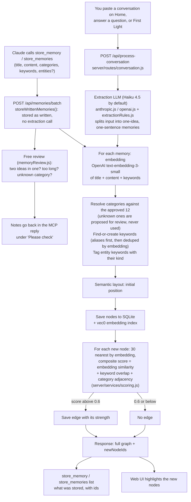
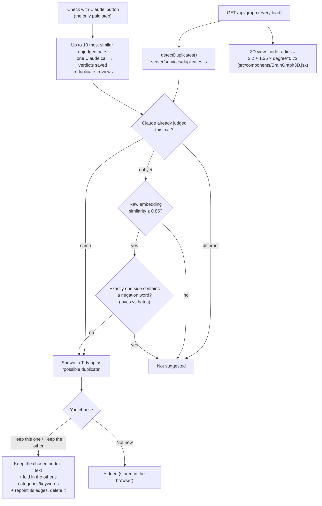

# Memory pipeline - how a memory gets into the brain

Last updated 2026-09-30. This covers the path from "something worth
remembering" to a node in the 3D view, plus how Tidy up acts on the result.

## The rule: one idea per memory, one sentence

Every memory should hold **one idea, in one plain sentence** (ideally under 25
words). When the input packs several ideas into one sentence, they get split
into separate memories. The reason is the 3D view: a node's size is its
**connection count** (`nodeRadius(degree)` in `src/components/BrainGraph3D.jsx`),
not its text length. A long node covering four topics connects to all four
and looks important for the wrong reason. With one idea per node, a big node
really is central.

The rule lives in three places. Keep them saying the same thing:

| Where | What it controls |
| --- | --- |
| `server/services/extractionRules.js` | The extraction prompt's "what is one memory" rules + worked example, shared by the Claude and GPT-4o extractors (pasted conversations and answers only) |
| `mcp-server/index.js` (`store_memory` schema and tool descriptions) | What Claude writes when it saves a memory - stored as written |
| `server/services/memoryReview.js` | Free checks on what Claude wrote (two ideas in one, too long), reported back to it |
| `CLAUDE.md` and `~/.claude/CLAUDE.md` | Same guidance for Claude sessions |

## Adding a memory

Two things to know:

- **Memories Claude saves are stored as written** (since 2026-10-07).
  Until then Haiku re-extracted every `store_memory` call as a second
  pass, which was nearly all of the app's running cost (COST.md #1). Now
  the Claude doing the saving is trusted to follow the one-idea rule, and
  a free review checks its work instead:
  - **Two ideas in one:** `candidateParts()` cuts the sentence where two
    clauses usually join (a new sentence, `;`, a spaced dash, or ", and /
    but / while / plus / also / whereas" - but not inside quotes or at the
    end of a list). The parts are embedded in one call (≈ $0.0000002) and
    if any two are less than `SPLIT_SIMILARITY` (0.22) alike, the reply
    says so. Picked with `scripts/calibrate-split-check.js` on 2026-10-07:
    of Sarah's 526 memories (already split by Haiku) 8 had a cut point and
    none scored under 0.22 (lowest 0.255, "...morning routine; she doesn't
    track it there yet"); 5 hand-made two-idea sentences scored 0.09-0.20
    and 6 one-idea ones 0.24-0.57. A small labelled set, so rerun it if
    the flags look wrong.
  - **Also flagged:** over 35 words, categories not in the 12 (dropped;
    Personal if none are left), no keywords.
  - Nothing is changed automatically. The MCP reply lists the notes under
    "Please check" with each memory's id, and the instructions tell Claude
    to fix them with `update_memory` / `store_memory`.
- **Entities:** Claude passes them on `store_memory` / `store_memories`
  (optional `entities: [{ name, kind }]`); for pasted text the extraction
  call says which keywords name a specific person, place, organisation or
  project (`ENTITY_RULE` in `extractionRules.js`). The kind is stored on
  the keyword (`keywords.kind`, `kind_source` = 'model'), only ever added,
  never removed, and never overwrites a type Sarah set by hand from the
  keyword popover. A keyword that already has a kind keeps it either way.
- **Aliases:** `keyword_aliases` maps old names to a keyword ("AI Brain" and
  "sarahs-brain" → Neuroverse). Extraction resolves aliases before matching,
  and keyword search also looks for the current name. (The merge route that
  created them was retired 2026-10-07.)
- Costs per call are in `COST.md` (embeddings only for `store_memory`;
  roughly $0.002 per pasted or answered text).

## After a memory is stored: Tidy up and the 3D view

Nothing merges automatically. Every merge is a button you click, and a
node's text never grows after extraction. There used to be a second
button, "Fold in as update" (Amend), which appended the other memory's text
as a dated paragraph. It was removed on 2026-09-30 because a memory that
adds something new should stay its own one-sentence node.

Why raw similarity and not the edge's `strength`: `strength` is the
composite "are these related?" score, which adds up to +0.25 for a shared
category and +0.18 for keyword overlap and caps at 1.0. Almost every memory
shares Research + Interests, so any two memories on the same topic hit 1.0.
Raw similarity alone can't reliably tell "same topic" from "same idea"
either (short sentences on one subject all land around 0.6–0.8), so 0.85
only catches near-verbatim repeats, and Claude judges the rest on demand.
Claude is told that a memory naming something specific (an algorithm,
tool, person, place...) is never a duplicate of a general one, so named
specifics survive as their own memories. A Claude verdict is invalidated if
either memory's text changes or `JUDGE_PROMPT_VERSION` is bumped.

"Tidy up" is the Home card that collects these suggestions. It used to
also list "Group together" and "Needs a parent" hierarchy suggestions;
those were removed on 2026-09-30.

## Open follow-ups

Ideas for later:

- An identity centerpiece ("Sarah" at the center, with everything linked to
  it), which similarity scoring can't produce on its own.
